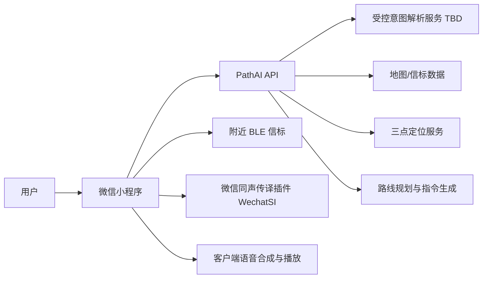
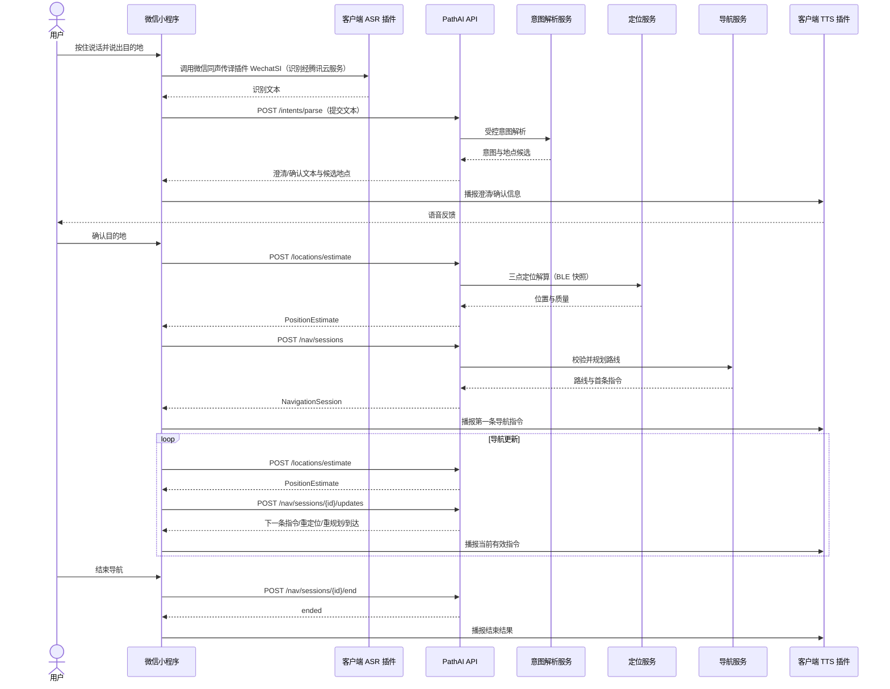

# PathAI 视障人士室内导航微信小程序

# 第一阶段前后端需求与 API 定义

- **文档类型：** 产品需求与接口契约
- **版本：** V1.0
- **适用范围：** 微信小程序第一阶段完整导航链路
- **上游需求：** `docs/视障人士室内导航微信小程序_PRD.md`
- **状态说明：** 本文定义开发协作所需的前后端行为与 API 草案；标注为 `[TBD]` 的项目需在技术评审时确认，不视为已定实现。

## 1. 文档目的与产品契约

本文将第一阶段产品需求转化为前端、后端可共同实现的模块要求与接口契约。第一阶段目标用户为全盲或低视力人士；用户在已部署信标、地图与路线数据的建筑内，通过语音指定目的地，系统估计用户位置、规划路线并以语音指引完成导航。

**完成条件：** 用户确认一个有效目的地后，系统开始导航；当导航引擎确认到达目标区域时播报到达并结束会话。用户也可主动结束。定位不可信、路线不可达或必要权限缺失时，系统不得继续提供确定性方向指令。

### 1.1 权威行为来源

- 第一阶段功能范围、用户流程、语音交互、异常处理及安全原则，以现有 PRD 为准。
- 路由算法遵循项目当前已实现规则：受限 Dijkstra、几何距离与门惩罚、拓扑节点限制、视障模式跨层走电梯；不得在接口文档中宣称尚未实现的多目标路由或定位精度为既成能力。
- 第一阶段定位算法选定为**蓝牙三点定位**（RSSI 测距 + 三边交汇实时解算）；惯性融合与地图匹配为后续增强目标，属于设计目标/未实现模块。本文定义输入输出契约，不代表已完成实现或精度验收。

## 2. 第一阶段范围

### 2.1 P0 范围

1. 小程序启动、必要权限检查、当前位置估计与语音反馈。
2. 按住说话、客户端语音转写、受控意图解析及客户端语音播报。
3. 目的地搜索、歧义澄清、目的地确认。
4. 获取室内地图与场所信息；由后端维护发布版本，小程序只读使用。
5. BLE 扫描及手机惯性数据采集、位置估计与置信度返回。
6. 创建导航会话、规划路线、生成按决策点组织的语音导航指令。
7. 持续位置更新、定位异常恢复、路线偏离后的重新规划、主动结束与到达结束。
8. 定位失败、网络/语音服务错误、地图或路线缺失等情况下的安全提示与恢复路径。

### 2.2 第一阶段不包含

- 实时摄像头地标识别、障碍物识别或动态避障。
- 动态施工、人流、临时封闭及多场馆运营能力。
- 管理后台 UI、在线地图编辑器、信标远程运维系统；地图由项目维护流程制作、校验并发布。
- 紧急呼叫中心、服务台协助工单、用户画像、客流分析、路线评价等能力。
- 大模型直接产生路线或执行导航动作。
- 将系统作为盲杖、导盲犬或专业出行辅助设备的替代品。

## 3. 系统边界与职责



| 能力        | 小程序前端                           | 后端服务                              |
| --------- | ------------------------------- | --------------------------------- |
| 权限与交互     | 检查平台权限；录音；按住说话；语音/震动反馈；导航状态控制   | 不代替平台权限弹窗；校验请求前置条件                |
| 语音处理      | 通过微信同声传译插件（WechatSI）识别语音为文本；播报后端返回的文本/结构化指令 | 接收识别文本；受控意图解析；候选地点匹配；返回可播报文本及指令 |
| BLE 与惯性数据 | 扫描信标；采集 RSSI、陀螺仪、加速度计及时间戳；按窗口聚合 | 校验数据；三点定位解算位置；返回坐标/区域、楼层、朝向、置信度与状态 |
| 地图与导航     | 缓存地图版本；呈现辅助界面；由客户端语音合成并播报后端提供的结构化指令 | 地点查询；读取已发布地图；规划路线；生成有地图依据的指令 |
| 安全处理      | 定位不可信时暂停确定性方向播报；网络/后台恢复时重校验会话   | 不可信定位不返回普通转向指令；不得捏造地点、地标或路线       |
| 会话管理      | 保存必要的会话恢复信息；开始、更新、结束导航          | 创建并维护导航会话状态；防止重复结束、跨用户访问或旧位置覆盖新状态 |

## 4. 用户、对象与状态

### 4.1 用户角色

- **导航用户：** 使用小程序查询位置、选择地点并导航。无需提供真实姓名等非必要身份资料。
- **地图维护者：** 通过项目受控发布流程提供地图、地点、信标位置及版本；第一阶段不提供小程序管理后台。

### 4.2 核心对象

| 对象                    | 说明             | 核心字段                                                                                                             |
| --------------------- | -------------- | ---------------------------------------------------------------------------------------------------------------- |
| MapVersion            | 已发布的场所地图版本     | `siteId`, `version`, `floors`, `publishedAt`                                                                     |
| Place                 | 可供查询或导航的目的地/地标 | `placeId`, `name`, `aliases`, `type`, `floor`, `nodeId`, `accessible`                                            |
| PositionEstimate      | 某一时刻的位置估计      | `x`, `y`, `floor`, `headingDeg`, `confidence`, `quality`, `observedAt`                                           |
| NavigationSession     | 一次导航任务         | `sessionId`, `status`, `destinationId`, `mapVersion`, `route`, `currentInstructionIndex`, `startedAt`, `endedAt` |
| NavigationInstruction | 由路线和地图生成的受控指令  | `instructionId`, `action`, `text`, `distanceM`, `landmark`, `priority`, `trigger`                                |

### 4.3 会话状态

| 状态           | 含义          | 可执行操作                    |
| ------------ | ----------- | ------------------------ |
| `active`     | 导航进行中       | 更新位置、获取重规划结果、重复当前指令、结束会话 |
| `recovering` | 定位暂不可信，等待恢复 | 上报新定位、结束会话；不得提供确定性方向指令   |
| `arrived`    | 后端确认到达      | 只读结果；不能继续更新位置            |
| `ended`      | 用户或系统结束     | 只读结果；不能恢复同一会话            |

会话状态只允许 `active ↔ recovering`（恢复可信后回到 active）、`active/recovering → arrived`、`active/recovering → ended`。终态不可逆。用户恢复小程序时，使用原 `sessionId` 查询状态；已结束或已到达时不得恢复为 active。

## 5. 前端需求

### FE-01 启动、权限与地图加载

- 启动后检查定位、蓝牙及使用语音输入所需权限/设备状态；需要时按平台规范请求授权。
- 首次使用播报基本操作；授权拒绝时说明受影响功能，不能展示或播报伪造的当前位置。
- 加载当前场所已发布地图版本与地点索引。地图不可用或版本不匹配时，禁止开始导航并提示重试/联系项目维护者。
- 获取当前位置必须满足后端定位质量策略；低置信度仅播报已确认楼层或区域，不播报精确点位。

### FE-02 按住说话与意图交互

- 在主交互热区单指按住开始录音，松开停止采集；录音开始、提交、识别中、失败等状态均提供语音或触觉反馈。
- 小程序通过微信同声传译插件（WechatSI）完成语音识别；识别结果显示为可访问的文本状态，并提交文本给 PathAI 后端，不上传原始音频到业务 API。
- 录音仅在用户明确按住交互期间进行；松开、取消、错误、切后台或系统音频中断时停止录音并释放音频资源。
- WechatSI 插件的授权、配额、网络依赖、错误状态与平台兼容性须经实际设备验证；不可用时告知用户并允许重试，不静默切换到未经确认的服务。
- 对无法识别、目的地缺失、歧义地点或不存在地点，通过客户端语音播报后端返回的澄清信息；用户选择候选项后才能进入确认。
- 目的地明确时客户端播报地点名、楼层并等待用户确认。用户语音确认或双击后才创建导航会话；取消则返回待命。
- 识别与意图解析失败不应启动导航；用户可重试或取消。

### FE-03 导航定位采集

- 仅在需要定位或导航时启动 BLE/惯性采集，并在结束后停止导航专用采集。
- 扫描结果按采样窗口合并，发送信标业务标识与 RSSI；不得默认上传手机侧任意蓝牙设备的 MAC 地址。
- 每批数据带客户端采集时间与单调递增序号，避免网络乱序导致旧位置覆盖新位置。
- 处理蓝牙关闭、无信标、权限撤回、传感器不可用、网络中断、切后台、锁屏及微信挂起；恢复前重查权限与会话状态。
- 定位质量为 `unreliable` 或 `lost` 时停止播报确定性转向，播报保守提示并进入恢复流程。

### FE-04 导航指令与地标播报

- 只播报服务端指令中的动作、距离、楼层和地图已标注地标；不得自行推测或让大模型补造地标/动作。
- 小程序通过 WechatSI 插件播报文本与导航指令，并提供统一播报队列：安全级提示可打断普通提示；新指令到达时丢弃已过期的普通提示。
- 网络不可用时，客户端仍应播报已收到并缓存的当前路线指令及本地安全提示；不得以缓存内容继续推进路线或播报过期转向。完全离线识别/合成能力不作承诺：已选定的 WechatSI 插件依赖腾讯云服务，无网时识别与合成均不可用。
- 客户端语音合成失败时，第一阶段不提供本地录音/系统语音兜底：通过震动及屏幕可访问文本告知语音不可用，并安全暂停导航。预录音频兜底留待后续版本评估。
- 地标是地图中的语义位置提示，不代表摄像头识别到了现场对象。若地图无相关地标或定位不支持该描述，省略地标，不影响路线动作正确性。
- 按决策点播报：转弯前预告，交叉口/门口再次确认；避免无变化的重复和过密播报。
- 安全优先级消息可打断普通提示。重复指令仅重播当前仍有效的指令，不重播过期路线信息。
- 楼层切换需要明确交通设施、目标楼层与到达后的下一步动作。视障模式跨层依当前路由规则使用电梯；若地图没有可用电梯路线则不启动导航。

### FE-05 会话结束与异常恢复

- 导航中双击或语音“结束导航/取消”均可结束当前会话，并播报结果。
- 收到 `arrived` 后播报“已到达”或“已到达附近”等与置信度相符的结果，停止扫描/传感器与路线提示。
- 收到定位异常后，立即停止不安全的确定性指令；恢复可信前不自动把缓存的旧路线提示当作当前指令。
- 后台恢复时先查询会话，再校验地图版本、权限与位置新鲜度，之后才恢复采集和播报。

## 6. 后端需求

### BE-01 身份与访问控制

- 小程序通过微信登录 code 换取本系统访问令牌；后端不将微信 code 或 AppSecret 暴露给客户端日志或其他服务。
- 每个导航会话绑定匿名用户主体；所有会话读取、更新、结束操作均校验归属。
- 地图读取接口只返回已发布版本；地图发布权限不开放给普通导航用户。
- 令牌机制、过期时间、刷新机制及微信登录不作为第一阶段强制前置依赖，采用免登录匿名访问，应另行确认防滥用与会话隔离方式。

### BE-02 意图解析与语音文本处理

- 客户端 ASR 统一经微信同声传译插件（WechatSI）实现；音频格式由插件内部约定，语言选项与单次识别时长限制按插件官方文档在小程序集成评审时确认；识别结果由客户端呈现并提交文本，不上传原始音频至 PathAI 业务后端。
- 客户端 ASR 的云端依赖、网络中断表现、隐私政策、授权方式与 iOS/Android 微信兼容性须经技术验证；“集成在客户端”不等于“完全离线”。
- 意图服务只接受文本及场所/地图上下文，返回受控枚举意图、结构化槽位、候选地点和可播报确认/澄清文本；服务端校验 schema、目的地存在性、当前状态和候选歧义。
- 支持第一阶段意图：`start_navigation`、`query_location`、`search_facility`、`cancel`、`end_navigation`、`repeat_instruction`、`unknown`。
- LLM/外部模型仅用于语言理解；路线由确定性路由服务生成。模型超时、越权输出或格式错误时安全失败。
- PathAI 后端不接收、不保存原始语音。识别文本只用于本次请求与会话处理，不默认长期保存或用于模型训练；如需诊断留存，必须经隐私评审并明确告知用户。

### BE-03 地图与地点服务

- 提供当前场所的已发布地图版本、楼层、地点和可导航拓扑所需数据。
- 地点至少包含稳定 ID、标准名称、别名、类别、楼层、拓扑关联及可播报名称；地标必须来自地点/地图记录。
- 地点搜索支持名称、别名、楼层和类别查询；多个结果按相关性返回有限候选供用户澄清。
- 地图、地点、拓扑、信标坐标及定位数据必须在同一 `mapVersion` 下可追溯；会话固定其启动时地图版本。版本失效时后端返回明确冲突，前端提示重新加载，不混用版本。
- 第一阶段地图导入、拓扑校验、发布与回滚通过受控的项目维护流程完成；后台界面不在范围内。

### BE-04 定位服务

- 接受 BLE 快照、可选惯性数据、楼层提示和采集时间，返回结构化位置及质量。第一阶段采用**蓝牙三点定位实时解算**：RSSI 经路径损耗模型转为估计距离，对 ≥3 个可见信标做三边交汇（最小二乘）得到估计位置；RSSI 先经滑动窗口滤波平滑，单次采样不直接作为精确距离。惯性数据为接口预留，第一阶段不参与位置解算。
- 校验时间戳、信标是否在当前场所/地图版本登记、RSSI 合法范围、批次序号及数据完整性。
- 输出 `confidence` 与 `quality`；置信度阈值及质量判定参数必须配置化，并按下方“定位参数确认方法”经现场测试确认 `[TBD]`。
- 低质量/过期输入返回 `unreliable` 或 `lost`，不输出可驱动转向的可靠坐标；跨楼层置信不足时 `floor` 可为空。
- 定位算法版本记录在结果中，便于测试结果复现。

#### 定位参数确认方法（现场标定流程）

适用于 BE-04 的路径损耗模型参数、`confidence` 分级阈值、`quality` 判定参数、RSSI 合法范围、快照新鲜度时限；同一方法也适用于偏航阈值、到达判定（BE-05/重规划）。所有数值均为 `[TBD]`，按以下流程得出后写入服务端配置并版本化。

**1. 布设真值标定点（10–20 个）**

覆盖教学楼代表性场景：直线走廊中段、走廊交叉口、门洞、楼梯口、电梯厅、开阔大厅、靠窗/金属遮挡区、已知信号弱区。每点用建筑图纸 + 激光测距/卷尺确定真实坐标，登记标定点表（点位 ID、楼层、坐标、环境备注），地面可贴临时标记保证复测一致。

**2. 静态采集**

每点站立 60–120 秒，用同一小程序版本采集 BLE 快照 + IMU；每点重复 3–5 次，并至少覆盖人流高峰/低谷两个时段。记录：估算坐标、`confidence`、`quality`、可见信标数、RSSI 分布。

**3. 动态采集**

沿 3–5 条已知路线正常步行（含乘电梯跨层），记录轨迹与真值路线的偏差、楼层切换时刻、偏航与到达事件的实际触发点。

**4. 数据分析 → 参数初值**

- 路径损耗模型参数：用标定点已知距离回归 RSSI–距离关系，得到基准功率与衰减指数初值；确认全场共用参数或按信标分批。
- 静态误差分布：按 `confidence` 分组统计 CEP50/CEP75/CEP90；`confidence` 阈值取“该值以上静态 CEP90 ≤ 导航可接受误差”的最低值。
- 楼层判定：统计静态楼层正确率与跨层期间 `floor` 置空时机，确定跨层置信参数。
- `unreliable`/`lost` 触发：遮挡或离开信标区后应秒级进入 `unreliable`，记录触发延迟与恢复时间，确定新鲜度时限。
- `quality` 参数：用采集数据回归“可见信标数、RSSI 方差、信标几何分布（三信标是否近共线/GDOP）、数据新鲜度 → 实际误差”的关系，得出 quality 判定初值。
- 安全侧偏置：两可取值一律偏高设置阈值，宁可多报 `unreliable`，不得漏报。

**5. 记录与冻结**

产出三份记录：标定点表、静态测试记录（点位/估算/误差/信标数/quality）、动态路线记录（路线/事件/触发时刻）。初值 → 回归测试（重跑全部动态路线）→ 通过后冻结为参数版本并写入 BE-04 配置。地图数据、信标增减或部署位置变更后，须重新执行本流程。

**6. 记录表模板（最小字段）**

| 表 | 字段 |
| --- | --- |
| 标定点表 | 点位 ID、楼层、真实坐标、环境备注、标记方式 |
| 静态测试 | 点位 ID、时间、小程序版本、算法版本、估算坐标、误差(m)、`confidence`、`quality`、可见信标数、RSSI min/max/均值 |
| 动态测试 | 路线 ID、时间、算法版本、偏航/到达/跨层事件、实际触发时刻、判定是否正确 |

### BE-05 路线规划与导航会话

- 创建会话前校验起点可用、目的地有效、地图版本有效、路线可达及视障模式可用的换层设施。
- 路线规划算法规则见下方“路线规划算法（第一阶段明确规则）”；若后端复用或移植已有逻辑，必须以同一规则集测试。没有实际实现的加权偏好不得向客户端宣称支持。
- 依据路线段、路径决策点和地图语义生成结构化导航指令；地标只允许从地图中读取。
- 每次导航位置更新按 `sequence` 有序处理；过期批次不得回退位置。偏航触发阈值 `[TBD]`，仅当位置质量可信时重规划。
- 到达判断由目标区域、位置质量和配置的停留条件综合决定；阈值与停留时长 `[TBD]`。到达事件每会话仅发生一次。
- 主动结束、到达、地图版本冲突与定位恢复均更新会话状态，并保证幂等。

#### 路线规划算法（第一阶段明确规则）

第一阶段路线规划采用项目已实现的**受限 Dijkstra**，完整定义以 [05-路线规划算法.md](file:///d:/code/pathai/docs/05-%E8%B7%AF%E7%BA%BF%E8%A7%84%E5%88%92%E7%AE%97%E6%B3%95.md) 为准；后端复用或移植时必须通过同一规则集的回归测试。

- **图模型**：来自空间语义地图的拓扑层 `nodes/edges`；节点类型为 `intersection`（交叉口）、`doorway`（门洞）、`room`（房间）、`facility`（设施）、`facility_entrance`（设施入口）；跨层通过 `crossFloorEdges` 建模为可通行边，与同层边由同一算法统一处理。
- **边权**：`W(e) = 几何距离 + 门惩罚`；门类型 `swing` / `fire` / `opening` 分别施加不同惩罚值，常量集中配置（`src/common/constants.py`）。**不使用**距离/转向/风险/拥挤度/能耗等多目标权重向量——该加权代价函数属于未实现设想，不得在 API 或客户端文案中宣称。
- **节点约束**：扩展路径时对中间节点施加类型白名单（同层/跨层各一组，`SAME_FLOOR_MID_TYPES` / `CROSS_FLOOR_MID_TYPES`），并应用门优先级规则。
- **视障模式跨层**：`blind` 模式跨层必须走电梯，楼梯跨层边不参与寻路；普通模式与轮椅模式可经电梯或楼梯。
- **无解回退**：受限寻路无解时按“最佳门 → 所有门 → 穿墙边”三层回退；穿墙回退结果须标记 `wall_fallback`，客户端提示路线可能经过非常规通道。
- **明确不支持**：多目标路线生成与评分、分层 A* 预处理均未实现；第一阶段仅输出单条最优路径。

第一阶段新增任何算法行为前，必须先在规则层实现并通过回归测试，不得仅通过 API 文档宣称支持。

## 7. 通用 API 约定

### 7.1 基本约定

- 基础路径：`/api/v1`。
- 除微信登录接口外，需访问令牌的请求发送 `Authorization: Bearer <accessToken>`。
- 请求/响应 JSON 使用 UTF-8；PathAI 业务 API 不接收语音文件。
- 距离单位为米；局部地图坐标单位为米，坐标系及原点由场所地图版本定义；角度使用度，`0°` 定义为地图坐标系正北或地图版本明确的基准方向 `[TBD]`。
- **API 示例数据为契约演示**：示例中的场所、楼层、地点、坐标、时间及令牌均为虚构值，不代表当前教学楼地图实际包含的楼层或地点；联调时以已发布地图版本的数据为准。
- 所有服务器时间使用 ISO 8601 UTC，例如 `2026-10-23T08:00:00Z`；客户端传感器事件时间同时包含相对单调时间或采集批次，避免设备时钟调整影响排序。
- 客户端可为创建会话、结束会话等可重试操作发送 `Idempotency-Key`。相同用户、相同 key、相同请求体返回原结果；相同 key 不同请求体返回 `409 IDEMPOTENCY_CONFLICT`。
- API 版本仅通过 `/v1` 演进；破坏性变更发布新主版本。

### 7.2 通用成功与错误结构

成功响应由各接口给出资源结构。错误统一为：

```json
{
  "error": {
    "code": "LOCATION_UNRELIABLE",
    "message": "暂时无法可靠确定当前位置",
    "retryable": true,
    "details": {}
  },
  "requestId": "req_01J..."
}
```

| HTTP 状态 | 使用情形               | 示例错误码                                                                |
| ------- | ------------------ | -------------------------------------------------------------------- |
| `400`   | JSON/schema/字段范围错误 | `INVALID_REQUEST`, `INVALID_SENSOR_BATCH`                            |
| `401`   | 令牌缺失、无效或过期         | `UNAUTHENTICATED`, `TOKEN_EXPIRED`                                   |
| `403`   | 用户无权访问资源           | `FORBIDDEN`                                                          |
| `404`   | 场所、地点、地图或会话不存在     | `SITE_NOT_FOUND`, `PLACE_NOT_FOUND`, `SESSION_NOT_FOUND`             |
| `409`   | 状态冲突、地图版本冲突、幂等键冲突  | `SESSION_NOT_ACTIVE`, `MAP_VERSION_CONFLICT`, `IDEMPOTENCY_CONFLICT` |
| `413`   | 请求体超出限制           | `PAYLOAD_TOO_LARGE`                                                     |
| `422`   | 输入有效但当前无法执行        | `DESTINATION_AMBIGUOUS`, `ROUTE_NOT_FOUND`, `LOCATION_UNRELIABLE`    |
| `429`   | 请求过于频繁             | `RATE_LIMITED`                                                       |
| `5xx`   | 服务/依赖故障            | `INTENT_SERVICE_UNAVAILABLE`, `INTERNAL_ERROR`                            |

客户端不得依赖 `message` 做逻辑分支；应按稳定的 `code` 决定状态，并将简明、安全的语音话术映射放在本地。`retryable` 表示是否可在不改变有效请求参数的情况下重试，不意味着应自动无限重试。

## 8. API 定义

### API-01 微信登录换取访问令牌

`POST /api/v1/auth/wechat`

请求：

```json
{
  "code": "微信登录临时 code"
}
```

成功 `200`：

```json
{
  "accessToken": "opaque-or-jwt-token",
  "tokenType": "Bearer",
  "expiresIn": 7200,
  "userId": "anon_..."
}
```

规则：

- `code` 只在 HTTPS 请求体中提交；不得写入客户端日志。
- `expiresIn` 单位秒。

**匿名主体创建规则（建议初值，经安全评审后冻结）：**

- **主体粒度**：每个微信用户（openid）对应一个匿名主体，跨会话复用、跨设备一致；同一 openid 重复登录不新建主体。
- **创建时机**：首次登录时后端用 `code` 调微信 `code2Session` 换取 openid，按哈希查找；不存在则创建匿名主体并返回 `userId`。
- **身份最小化**：服务端只保存加盐 openid 哈希（盐为服务端配置），不保存明文 openid、昵称、头像等任何身份资料；`userId` 格式为 `anon_<sha256(openid+salt) 截取前 16 位>`，不可逆推回 openid。
- **令牌**：服务端签发随机 opaque 令牌（≥128 bit 熵），有效期建议 **7200 秒**；令牌与服务端主体映射存储（便于吊销），不使用自包含 JWT 承载主体信息。过期后客户端静默重调 `wx.login` + 本接口换取新令牌，全程无用户交互。
- **并发登录**：允许多设备同时登录，各自持有独立令牌；令牌不互相踢除。
- **注销与留存**：令牌随过期自然失效；主体及其轨迹、识别文本的删除/留存执行第 9 节“数据留存策略”。

失败返回 `401 AUTH_CODE_INVALID` 或 `5xx AUTH_PROVIDER_UNAVAILABLE`。

### API-02 获取当前地图版本及楼层摘要

`GET /api/v1/sites/{siteId}/map?version=latest`

成功 `200`：

```json
{
  "siteId": "school-building-01",
  "mapVersion": "2026-10-01.1",
  "publishedAt": "2026-10-01T08:00:00Z",
  "coordinateSystem": {
    "unit": "m",
    "originDescription": "由本地图版本定义",
    "headingReference": "map_north"
  },
  "floors": [
    { "floorId": "1", "displayName": "一楼", "level": 1 },
    { "floorId": "2", "displayName": "二楼", "level": 2 }
  ],
  "dataUrl": "https://.../map-data.json",
  "dataSha256": "..."
}
```

规则：

- 返回不可变发布版本与完整数据下载地址；客户端可用 `ETag`/`If-None-Match` 缓存，未变更时返回 `304`。
- 地图包至少包含可通行拓扑、地点/地标目录、跨层连接、相关障碍/风险语义及该版本的信标映射；具体地图包 schema 需以现有 GeoJSON/地图文件为基础，在接口实现前冻结 `[TBD]`。
- `dataUrl` 只允许 HTTPS；下载内容摘要必须与 `dataSha256` 相符。
- 后端未发布地图时返回 `404 MAP_NOT_PUBLISHED`。

### API-03 地点查询

`GET /api/v1/sites/{siteId}/places?q={query}&floor={floorId}&type={type}&limit={limit}`

成功 `200`：

```json
{
  "mapVersion": "2026-10-01.1",
  "items": [
    {
      "placeId": "library-301",
      "name": "三楼图书馆",
      "spokenName": "三楼图书馆",
      "aliases": ["图书馆"],
      "type": "library",
      "floorId": "3",
      "nodeId": "node_301_entry",
      "accessible": true
    }
  ],
  "nextCursor": null
}
```

规则：

- `q` 可为空；不传时按可导航地点列表返回，具体上限 `[TBD]`。
- `limit` 默认为 10，最大值 `[TBD]`；排序由名称相关度与稳定 ID 决定。
- 不返回不可导航或未发布地点。无结果返回空 `items`，不是错误。
- 意图解析返回多个地点候选时，候选地点使用同一资源结构，并必须与 `mapVersion` 一致。

### 语音能力选型：微信同声传译插件（WechatSI）

**选型结论：**第一阶段客户端语音识别（ASR）与文本转语音（TTS）采用微信同声传译插件（WechatSI）。ASR 识别文本后调用 `POST /api/v1/intents/parse`，TTS 播报后端返回的澄清文本、状态文本和导航指令。该插件由微信托管，识别与合成经腾讯云服务完成，客户端集成不代表完全离线；接入前仍须完成下述验证门槛。

**接入方式：**在小程序管理后台“设置 → 第三方设置 → 插件管理”添加“微信同声传译”插件，在 `app.json` 的 `plugins` 字段声明插件 appid 与版本，代码通过 `requirePlugin('WechatSI')` 获取语音识别管理器与 TTS 接口。具体接口、语言选项与参数限制以插件官方文档为准。

| 方案 | 说明 | 在本阶段的角色 |
| --- | --- | --- |
| [微信同声传译插件（WechatSI）](https://developers.weixin.qq.com/miniprogram/dev/platform-capabilities/extended/translator.html) | 微信官方插件，提供实时语音识别与文本转语音（含中文）；插件本身不是开源组件，官方文档列有调用配额、网络错误及 TTS 文本长度限制。 | **选定方案**：接入路径最直接，服务与更新由微信/腾讯托管，无需自管模型与密钥。导航提示按插件限制切分短句，安全提示不依赖单次长文本合成。 |
| [Face2FaceTranslator 示例](https://github.com/Tencent/Face2FaceTranslator) | 腾讯开源的微信小程序示例（MIT 许可），基于 WechatSI 插件；开源的是示例代码，不代表插件本身或其云服务开源。 | **接入参考**：参考其插件声明与调用方式，不作为独立 ASR/TTS 引擎。 |
| [sherpa-onnx](https://github.com/k2-fsa/sherpa-onnx) | 开源语音运行时，支持本地 ASR/TTS 与 WebAssembly；存在 WASM 路径，但未证实可直接运行于微信小程序。 | **离线备选**：仅当后续出现强离线需求时，另行立项做小程序适配原型（WASM 兼容性、模型加载、包体积、性能）；不阻塞第一阶段。 |

**选型理由：**第一阶段目标是验证教学楼场景的导航流程，WechatSI 接入成本最低、由微信平台托管、无需自管模型与密钥；其非开源与云服务依赖在当前阶段可接受，前提是完成隐私告知与合规检查。若接入验证发现配额、识别质量或离线要求不满足，再评估 sherpa-onnx 等自托管方案。

**接入验证门槛：**在目标基础库及真实 iOS/Android 微信版本上验证插件添加与授权、录音开始与取消/打断/切后台恢复、无网行为及错误反馈；用教学楼地点名/别名语料测试普通话识别准确性；测量识别和播报延迟、TTS 可懂度、连续/短句播报稳定性与配额消耗。任一项不满足时回到选型评审，不得承诺离线能力。

资料核对日期：2026-10-24。插件接口、限制与配额以 [微信同声传译官方文档](https://developers.weixin.qq.com/miniprogram/dev/platform-capabilities/extended/translator.html) 为准；示例开源许可与依赖关系见 [Face2FaceTranslator 仓库](https://github.com/Tencent/Face2FaceTranslator)。

- PathAI 业务后端不提供音频上传或 TTS 合成 API，也不接收原始语音。
- 客户端 ASR/TTS 统一经 WechatSI 插件实现；插件配额、语言选项、单次合成时长限制、网络依赖、平台兼容性及离线限制经真机验证后冻结。
- 客户端语音识别错误由客户端捕获，并转化为可访问的提示和重试操作；WechatSI 由微信托管，不涉及第三方服务密钥写入小程序包。
- 客户端 TTS 失败时按 FE-04 规定执行安全降级；导航文字/动作以服务端结构化响应为准。
- WechatSI 的识别与合成经腾讯云服务处理；上线前完成用户隐私保护指引配置、供应商数据流梳理与小程序平台合规检查。

### API-04 受控意图解析

`POST /api/v1/intents/parse`

请求：

```json
{
  "siteId": "school-building-01",
  "mapVersion": "2026-10-01.1",
  "text": "带我去三楼图书馆",
  "sessionId": null,
  "locale": "zh-CN"
}
```

成功 `200`（唯一匹配）：

```json
{
  "intentId": "intent_...",
  "intent": "start_navigation",
  "confidence": 0.93,
  "needsClarification": false,
  "destination": {
    "placeId": "library-301",
    "name": "三楼图书馆",
    "floorId": "3"
  },
  "candidates": [],
  "responseText": "准备导航到三楼图书馆，请确认。"
}
```

成功 `200`（需要澄清）：

```json
{
  "intentId": "intent_...",
  "intent": "start_navigation",
  "confidence": 0.61,
  "needsClarification": true,
  "destination": null,
  "candidates": [
    { "placeId": "library-301", "name": "三楼图书馆", "floorId": "3" },
    { "placeId": "library-201", "name": "二楼图书馆", "floorId": "2" }
  ],
  "responseText": "找到两个图书馆，请说二楼或三楼。"
}
```

允许 `intent`：`start_navigation`, `query_location`, `search_facility`, `cancel`, `end_navigation`, `repeat_instruction`, `unknown`。

规则：

- 后端对枚举、置信度、地点 ID 与地图版本进行 schema 校验；外部模型原始响应不直接返回前端。
- 低置信度、意图不支持、地点不存在或多义时设置 `needsClarification=true`，不得创建导航会话。
- `cancel`、`end_navigation`、`repeat_instruction` 只描述用户意图；是否可执行还须校验对应会话状态。
- `responseText` 只用于澄清/确认语句，不可作为路线指令来源。

### API-05 位置估计

`POST /api/v1/locations/estimate`

请求：

```json
{
  "siteId": "school-building-01",
  "mapVersion": "2026-10-01.1",
  "sequence": 18,
  "collectedAt": "2026-10-23T08:00:00Z",
  "floorHint": "1",
  "beacons": [
    { "beaconId": "B-001", "rssi": -67, "observedAt": "2026-10-23T08:00:00Z" },
    { "beaconId": "B-002", "rssi": -75, "observedAt": "2026-10-23T08:00:00Z" }
  ],
  "imu": {
    "samples": [
      {
        "timestampMs": 28100412,
        "gyroRadS": [0.01, 0.00, -0.02],
        "accelMS2": [0.11, 0.02, 9.72]
      }
    ],
    "headingDeg": 42.0
  }
}
```

`imu`、`floorHint` 可空；第一阶段仅使用 BLE 快照做三点定位解算，惯性字段为接口预留。RSSI 接受范围、采样频率与快照窗口 `[TBD]`。

成功 `200`：

```json
{
  "estimateId": "loc_...",
  "sequence": 18,
  "mapVersion": "2026-10-01.1",
  "position": { "x": 12.4, "y": 8.1, "floorId": "1" },
  "headingDeg": 41.5,
  "confidence": 0.82,
  "quality": "reliable",
  "matchedArea": { "placeId": "main-corridor", "name": "一楼走廊" },
  "algorithmVersion": "location-0.1",
  "paramsVersion": "loc-2026-11-01.1",
  "observedAt": "2026-10-23T08:00:00Z"
}
```

定位质量枚举：`reliable`, `degraded`, `unreliable`, `lost`。

规则：

- `unreliable` / `lost` 时 `position` 可为 `null`；`floorId` 在不能可靠判定楼层时为 `null`。
- 若 `sequence` 小于本客户端/会话已处理序号，返回 `409 STALE_LOCATION_BATCH`，不得覆盖新结果。
- 未知信标 ID 可在 `ignoredBeaconIds` 中返回，不将其强行参与估计。
- `paramsVersion` 标识本次解算使用的参数集（`PATHAI_LOCATION_*`），用于与 `mapVersion`/`algorithmVersion` 一起追溯；导航会话创建时固化并在创建/查询响应返回（docs/28 §5.4）。
- 地图版本不一致返回 `409 MAP_VERSION_CONFLICT`；定位阈值与 `confidence` 到 `quality` 的映射必须经测试定标 `[TBD]`。

### API-06 创建导航会话并规划路线

`POST /api/v1/nav/sessions`

请求：

```json
{
  "siteId": "school-building-01",
  "mapVersion": "2026-10-01.1",
  "origin": {
    "x": 12.4,
    "y": 8.1,
    "floorId": "1",
    "confidence": 0.82,
    "observedAt": "2026-10-23T08:00:00Z"
  },
  "destinationId": "library-301",
  "userMode": "blind",
  "locale": "zh-CN"
}
```

成功 `201`：

```json
{
  "sessionId": "nav_...",
  "status": "active",
  "mapVersion": "2026-10-01.1",
  "destination": {
    "placeId": "library-301",
    "name": "三楼图书馆",
    "floorId": "3"
  },
  "route": {
    "routeId": "route_...",
    "distanceM": 126.5,
    "estimatedDurationSec": null,
    "polyline": [
      { "x": 12.4, "y": 8.1, "floorId": "1" },
      { "x": 20.0, "y": 8.1, "floorId": "1" }
    ],
    "segments": [
      {
        "segmentId": "seg_1",
        "action": "continue",
        "text": "请沿走廊直行。",
        "distanceM": 18.0,
        "landmark": null,
        "priority": "normal",
        "trigger": { "type": "distance", "valueM": 12.0 }
      }
    ]
  },
  "createdAt": "2026-10-23T08:00:01Z"
}
```

动作枚举至少包括 `continue`, `turn_left`, `turn_right`, `enter_elevator`, `exit_elevator`, `arrive`, `stop`, `relocalize`；优先级包括 `normal`, `turn`, `safety`。预计耗时尚无经验证模型，可为 `null`。

规则：

- 仅在用户确认目的地后调用；一个活动导航会话对应一次明确导航任务。
- `origin.confidence` 必须满足服务端配置阈值，否则 `422 LOCATION_UNRELIABLE`。
- 当前路线不可达时 `422 ROUTE_NOT_FOUND`；盲模式需跨层但没有可用电梯时返回 `422 ACCESSIBLE_ROUTE_NOT_FOUND`。
- 创建时记录地图版本、定位算法版本与路由规则版本。
- 请求使用 `Idempotency-Key`，以应对网络重试而不创建多个会话。

### API-07 导航位置更新与下一事件

`POST /api/v1/nav/sessions/{sessionId}/updates`

请求：

```json
{
  "sequence": 19,
  "location": {
    "x": 15.1,
    "y": 8.0,
    "floorId": "1",
    "confidence": 0.79,
    "quality": "reliable",
    "observedAt": "2026-10-23T08:00:03Z"
  }
}
```

成功 `200`（继续路线）：

```json
{
  "sessionId": "nav_...",
  "status": "active",
  "event": "instruction",
  "instruction": {
    "instructionId": "ins_2",
    "action": "turn_right",
    "text": "前方路口请右转。",
    "distanceM": 6.0,
    "landmark": {
      "placeId": "service-desk-1",
      "name": "服务台",
      "relativeDirection": "left",
      "distanceM": 4.0
    },
    "priority": "turn",
    "trigger": { "type": "decision_point", "nodeId": "intersection-17" }
  },
  "routeChanged": false,
  "processedSequence": 19
}
```

定位不可信：

```json
{
  "sessionId": "nav_...",
  "status": "recovering",
  "event": "relocalizing",
  "instruction": {
    "instructionId": "ins_relocate",
    "action": "relocalize",
    "text": "正在重新确定位置，请暂缓前行。",
    "distanceM": null,
    "landmark": null,
    "priority": "safety",
    "trigger": { "type": "immediate" }
  },
  "routeChanged": false,
  "processedSequence": 19
}
```

到达：`status` 为 `arrived`，`event` 为 `arrived`，返回到达指令且 `routeChanged=false`。

规则：

- 前端可先调用 API-05 获取估计，再调用此接口；如服务端选择合并两步，后续可用新版本接口替代，不得静默改变本合同。
- 当前版本每次请求提交一个已完成位置估计；更新频率 `[TBD]`，需考虑小程序网络、耗电和定位稳定性。
- 后端只在位置质量可信时判断偏航、推进决策点及判定到达；必要时返回 `event="reroute"` 与新的 `route/segments`。
- 相同/较旧 `sequence` 不重复推进状态；可返回已处理事件或 `409 STALE_NAV_UPDATE`。
- 会话非 `active`/`recovering` 时返回 `409 SESSION_NOT_ACTIVE`。

### API-08 查询与恢复导航会话

`GET /api/v1/nav/sessions/{sessionId}`

成功 `200`：

```json
{
  "sessionId": "nav_...",
  "status": "active",
  "siteId": "school-building-01",
  "mapVersion": "2026-10-01.1",
  "destination": { "placeId": "library-301", "name": "三楼图书馆", "floorId": "3" },
  "currentInstruction": { "instructionId": "ins_2", "text": "前方路口请右转。", "action": "turn_right" },
  "lastProcessedSequence": 19,
  "updatedAt": "2026-10-23T08:00:03Z"
}
```

规则：

- 仅会话所属用户可访问。终态返回终态与结束原因，不返回仍可执行的旧指令。
- 小程序恢复时仍须重新验证定位质量；读取会话本身不表示允许立即继续行走。

### API-09 结束导航会话

`POST /api/v1/nav/sessions/{sessionId}/end`

请求：

```json
{
  "reason": "user_cancelled"
}
```

`reason` 枚举：`user_cancelled`, `user_finished`, `arrived`, `system_error`。

成功 `200`：

```json
{
  "sessionId": "nav_...",
  "status": "ended",
  "reason": "user_cancelled",
  "endedAt": "2026-10-23T08:01:00Z"
}
```

规则：

- 结束接口幂等；重复结束返回当前终态，不重复记录状态迁移。
- `arrived` 应由后端到达判断触发，不允许客户端仅凭自身判断伪报到达。
- 结束后前端停止导航专用采集和播报；服务器按第 9 节“数据留存策略”处理数据（会话记录 ≤ 360 天，位置批次即用即弃）。

## 9. 安全、隐私与运行约束

1. 所有 API 使用 HTTPS；令牌、识别文本、位置和导航会话数据不得写入明文日志。录音只在客户端语音组件处理，客户端不得将音频写入应用日志。
2. 只收集完成定位/导航所需的最少信标和传感器数据；未经明确同意，不将语音/轨迹用于模型训练。
3. 服务端返回的路线与位置均须带地图版本；版本不一致时停止导航指令，先同步地图。
4. 定位质量不足、数据过期或楼层不确定时，以安全提示替代方向指令。
5. 高风险安全提示不能被普通提示覆盖；客户端不以颜色、地图或视觉 UI 作为唯一反馈渠道。
6. PathAI 业务后端不接收原始语音。客户端 ASR/TTS 经 WechatSI 插件由腾讯云服务处理，须在上线前完成必要的告知、授权、供应商隐私评审、数据流梳理和小程序平台合规检查。
7. 识别文本只为意图解析与当前会话所需；不默认长期保存或用于模型训练。诊断日志应脱敏并避免记录原始文本；如确需留存，须明确目的、范围、期限和删除方式。
8. 小程序后台运行与锁屏能力受微信/iOS/Android 平台限制；不能承诺被系统挂起时持续导航。切回前台必须查询会话并重定位。
9. 位置批次、路线日志的存储时长、删除流程、日志脱敏及地域要求按下方“数据留存策略（建议初值）”执行，上线前经隐私评审冻结。
10. 系统需明确告知用户：导航仅为研究/辅助信息，出行仍需结合盲杖、导盲犬、陪同及现场判断；未经风险测试不得对外宣称可独立保障人身安全。

### 数据留存策略（建议初值，经隐私评审后冻结）

所有数据存储于中国境内；按“能不存就不存、必须存的最小化并限期删除”执行。

| 数据类别 | 建议留存 | 处理方式 |
| --- | --- | --- |
| 识别文本（ASR 转写） | 不持久保存 | 仅在意图解析与会话处理期间使用，处理完即弃；错误诊断确需留存时脱敏后 ≤ 7 天，并经隐私评审与用户告知 |
| 位置批次（BLE 快照、估算坐标） | 会话内即用即弃 | 不构建长期轨迹库；定位质量分析仅使用剥离用户关联的匿名化/聚合数据，留存 ≤ 30 天 |
| 导航会话记录 | ≤ 360 天 | 起终点、状态变更、结束原因，用于问题排查；到期自动删除 |
| 服务端应用日志 | ≤ 360 天 | 结构化脱敏日志，不含识别文本原文、完整坐标与令牌 |
| 令牌↔主体映射 | 随令牌过期即删 | 吊销时立即删除 |
| 匿名主体记录（openid 哈希） | 180 天不活跃自动删除 | 或用户请求删除时立即删除 |
| 现场标定/测试数据 | 长期保留 | 不含真实用户数据，作为算法与参数基线 |

**删除流程：**到期数据由定时任务自动删除（含备份轮转周期覆盖到的副本）；用户申请删除主体时，同步删除主体记录及关联会话、位置数据。第一阶段提供联系邮箱受理删除请求；正式对外发布前按平台要求补充自助注销能力。

## 10. 端到端时序




## 11. 验收范围

### 前端验收

- 权限允许/拒绝、蓝牙关闭、无信标、麦克风拒绝均有非视觉反馈；无法定位时不声称已知位置。
- 按住说话松开后客户端停止录音并完成 ASR；仅识别文本提交至意图解析 API，音频不上传 PathAI 后端；ASR、意图解析、澄清和取消均有清晰状态反馈。
- 客户端 TTS 可播报服务端确认/澄清文本及导航指令；合成失败按降级流程提示，语音不可用时不会无声地继续确定性导航。
- 目的地必须经过确认才创建会话；双击仅在 PRD 指定状态执行对应操作。
- 导航指令只依赖后端受控结构；重复指令不会重播过期路线；定位不可信时不会播报确定性转向。
- 主动结束、到达、网络中断及切后台恢复均能正确停止/重建必要资源。

### 后端验收

- API schema 校验、鉴权、会话归属校验、地图版本检查及幂等规则符合本文。
- 未知/过期信标数据、乱序位置批次与低置信度定位不能推动导航状态或到达判断。
- 地点歧义不会被静默选定；无路可达时不创建活动会话。
- 返回的路线、地标和指令均可追溯至已发布地图及路由结果；模型不能直接产生行动指令。
- `active → recovering → active` 恢复及 `active/recovering → arrived/ended` 终止行为通过状态测试。
- 所有 API 失败均返回稳定错误码与 `requestId`，不泄露密钥、音频内容或其他用户会话信息。

### 联调/场地验收

- 在目标 iOS/Android 微信版本及指定信标/地图区域内验证 BLE 扫描、权限生命周期、采样序号、地图版本、路线指令与语音播放。
- 定位误差、楼层识别率、错误转向率、到达判定、恢复时间、端到端延迟与功耗目标均在实测后设定；本文不预设未经验证的性能承诺。
- 视障参与者测试须有安全监护与风险控制；未通过安全评审前，仅开展受控模拟测试。

## 12. 待技术评审冻结的参数

| 项目         | 当前处理              | 冻结前需确认                           |
| ---------- | ----------------- | -------------------------------- |
| 微信登录/匿名会话  | 定义 token 接口草案与匿名主体创建规则（建议初值） | 规则经安全评审冻结；是否强制登录          |
| 客户端 ASR/TTS 集成 | 已选定微信同声传译插件（WechatSI），详见“语音能力选型”章节 | 配额与可用性、授权、云端依赖、兼容性、离线限制、TTS 失败降级流程及隐私评审 |
| 地图包 schema | API 返回版本与不可变下载地址 | 基于现有 GeoJSON/拓扑数据冻结面向客户端的 schema |
| 定位算法与质量阈值  | 已选定蓝牙三点定位；定义返回契约 | 路径损耗模型参数、坐标系、置信度映射与实测阈值       |
| 采样策略       | 定义采集字段和序号         | BLE/IMU 采样窗口、上传周期、批次上限及耗电        |
| 重规划与到达     | 定义触发边界            | 偏航阈值、目标区域、停留时长及重复事件处理            |
| 语音播报       | 服务端返回结构化文本/指令；客户端负责 TTS | WechatSI 运行参数、播报优先级与 TTS 失败降级（震动+可访问文本+安全暂停）实现 |
| 数据留存       | 已定义留存策略建议初值（第 9 节） | 期限与删除流程经隐私评审冻结；注销能力实现       |
| 可靠性目标      | 由现场测试确定           | API 可用性、各阶段超时、错误恢复和测试指标          |

***

**安全原则：** 语音/模型理解用户“想去哪里”；地图、定位与确定性导航引擎判断“用户在哪里、应该怎么走”；小程序负责无障碍交互。任何服务都不得用推测填补不确定位置或不存在的地标。
