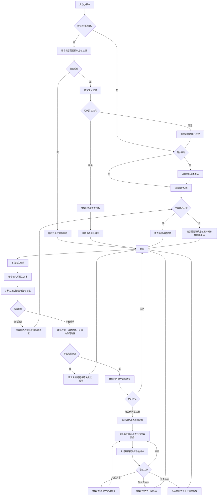

# 视障人士室内导航微信小程序 PRD

- **文档版本：** V1.0
- **产品形态：** 微信小程序
- **产品目标：** 帮助视障人士通过语音交互与室内定位能力，完成从当前位置到指定目的地的自主导航。
- **核心交互原则：** 尽量不依赖视觉；支持单手操作；语音提示简洁明确；对定位不确定、指令无法识别等情况提供清晰反馈。

## 1. 产品范围

### 1.1 本期目标

围绕一条完整导航链路实现最小可用版本：

0. 用户首次启动小程序时，系统发起定位权限授权请求。
1. 每次启动小程序时，系统检查定位权限状态；未授权时语音提示“定位导航功能需要授权定位权限”。首次启动时，用户同意或拒绝后分别语音提示“定位导航功能已授权”或“定位导航功能未授权”。
2. 首次启动时，系统语音说明基本用法，例如“请按住屏幕任意位置，说‘带我去三楼图书馆’，即可发起导航请求”。
3. 已授权时，系统获取并语音播报当前位置，例如“您现在位于一楼大厅”；未授权或定位不可用时，不得假定用户位置已知。
4. 用户单指按住屏幕任意位置启动语音输入；系统将语音转换为文本，并调用大模型识别意图、提取目的地或操作意图。
5. 用户确认目的地后开始导航。导航期间使用手机陀螺仪、加速度计及蓝牙信标信号辅助估计位置、朝向和行进状态，并生成语音导航提示。
6. 用户在目的地确认阶段可双击屏幕确认并开始导航；导航过程中双击屏幕结束导航。到达目的地后，系统自动播报到达信息并结束导航。

### 1.2 本期暂不包含

- 摄像头实时障碍物识别与避障。
- 导航路线中的动态施工、临时封路实时更新。
- 多楼栋、室外与室内无缝导航（可作为后续版本）。
- 紧急呼叫中心或专业救援服务。
- 大模型直接生成自由形式的导航动作；导航动作必须由受控的导航引擎和地图数据产生。

## 2. 目标用户与使用场景

### 2.1 目标用户

- 主要用户：全盲或低视力人士。
- 辅助用户：帮助配置地图、蓝牙信标和目的地数据的管理员或志愿者。

### 2.2 典型场景

- 用户进入已部署蓝牙信标的建筑，打开小程序，听取当前位置播报。
- 用户按住屏幕说“带我去三楼图书馆”，系统识别意图并播报目的地，用户语音确认或双击后开始导航。
- 用户开始导航，按照语音指令在室内行走。
- 用户误触、临时取消或需要终止导航时，通过语音“取消”或双击（导航过程中）结束操作。
- 用户到达目的地，系统自动播报并结束导航。

## 3. 核心用户流程



## 4. 功能需求

优先级定义：
- **P0：** 首版必须交付。
- **P1：** 首版可选或紧随其后交付。
- **P2：** 后续版本规划。

### 4.1 启动与当前位置播报

**需求编号：** NAV-001  
**优先级：** P0

**描述：** 用户打开小程序后，系统先检查定位权限；首次启动请求授权并语音说明基本用法。已授权时自动尝试定位并语音播报当前位置。

**功能要求：**
1. 每次启动后自动检查定位权限与定位服务状态。
2. 首次启动时请求定位权限；用户同意或拒绝后分别语音播报“定位导航功能已授权”或“定位导航功能未授权”。
3. 每次启动发现权限未授权时，语音提示“定位导航功能需要授权定位权限”；未授权期间不得将定位视为可用，并提示用户授权后重试或开启权限。
4. 首次启动时语音播报小程序基本使用方式，例如“请按住屏幕任意位置，说出目的地即可发起导航请求”。
5. 已授权时，读取蓝牙信标扫描结果，并结合最近一次可用位置、地图拓扑及定位算法计算当前位置。
6. 当位置可信时，播报楼栋、楼层及语义化地点，例如“您现在位于一楼大厅”。
7. 当位置仅能确定到区域时，播报已知范围，例如“您现在位于一楼，靠近大厅”。
8. 当位置不可信或无法确定时，不得编造位置；应播报“暂时无法确定当前位置，请在附近缓慢移动后重试”。
9. 完成权限提示、首次使用说明及位置播报后进入待命状态；未授权时仅开放不依赖当前位置的交互，并在导航前再次校验权限。

**验收标准：**
- 在已部署信标且地图完整的测试区域内，能播报预期的语义化位置。
- 定位置信度低于配置阈值时，不播报未经确认的精确位置。
- 权限被拒绝、蓝牙关闭或信标不可用时，能给出可理解的语音提示。

### 4.2 按住屏幕进行语音输入

**需求编号：** VOICE-001  
**优先级：** P0

**描述：** 用户单指按住屏幕任意位置启动语音输入，松开后结束录音并提交识别。

**功能要求：**
1. 除系统弹窗、输入法等系统保留区域外，主交互区域支持按住说话。
2. 按下时立即提供语音或震动反馈，例如“请说出目的地”。
3. 按住期间持续采集语音；松开后停止录音并提交语音识别。
4. 录音过程中显示状态仅作为视觉补充，不能是唯一反馈。
5. 录音时遇到权限缺失、录音失败或超时，应语音提示原因。
6. 语音输入应设置合理的最长时长和静音超时，具体参数由测试确定。
7. 小程序生命周期切换、来电或音频中断时，应停止或安全结束录音，并告知用户。

**验收标准：**
- 用户无需找到特定小按钮即可在主页面任意可交互区域启动按住说话。
- 按下、录音中、提交、失败等关键状态均有非视觉反馈。
- 松开后不继续采集麦克风音频。

**交互注意事项：**
- “任意位置按住”与系统控件、微信手势、屏幕阅读器手势可能冲突。实现时应在微信小程序支持范围内定义明确的主交互热区，并开展 VoiceOver/TalkBack 等辅助技术兼容测试。
- 双击在目的地确认阶段用于确认并开始导航，在导航过程中用于结束导航；其他状态下不应误启动导航。

### 4.3 语音识别与大模型意图识别

**需求编号：** NLP-001  
**优先级：** P0

**描述：** 将用户语音转换为文本，再通过大模型解析意图和参数。大模型负责理解自然语言，不直接决定实际行走路径。

**支持的首期意图：**

| 意图 | 用户示例 | 系统行为 |
|---|---|---|
| 导航到目的地 | “带我去图书馆” | 解析目的地并进入确认流程 |
| 查询当前位置 | “我现在在哪里” | 播报当前位置 |
| 查询设施 | “附近有卫生间吗” | 返回附近设施并询问是否导航 |
| 取消当前操作 | “取消” | 取消当前语音输入或目的地确认 |
| 结束导航 | “结束导航” | 结束当前导航 |
| 重复指令 | “再说一遍” | 重复当前语音提示 |
| 无法识别 | 含糊或无关表达 | 请求用户重说或澄清 |

**结构化解析结果建议：**

```json
{
  "intent": "start_navigation",
  "destination_query": "三楼图书馆",
  "floor": 3,
  "confidence": 0.93,
  "needs_clarification": false
}
```

以上为示例结构。实际接口应由后端定义并进行 schema 校验。

**功能要求：**
1. 语音识别服务输出文本及可用的识别置信度。
2. 大模型仅返回受控的意图类型和结构化参数，不返回可直接执行的任意系统命令。
3. 服务端校验意图、目的地、楼层、权限和地图中是否存在该地点。
4. 若存在多个匹配地点，应通过语音列举有限候选并让用户选择。
5. 低置信度、缺少目的地或目的地不存在时，必须澄清，不得自动开始导航。
6. 网络不可用或大模型调用失败时，应提示用户重试；若可行，可提供有限的本地规则兜底。
7. 不向大模型发送与任务无关的个人信息；语音数据和文本的保存策略需在产品上线前明确。

**验收标准：**
- 覆盖首期意图的标准测试语句、口语表达、同义表达及歧义表达。
- 对未确认或地图中不存在的目的地，不会启动导航。
- 模型返回格式错误、超时或异常时，系统安全失败并给出提示。

### 4.4 目的地确认与导航启动

**需求编号：** NAV-002  
**优先级：** P0

**描述：** 在导航启动前确认目标地点，并检查定位、地图和传感器条件。

**功能要求：**
1. 目的地唯一且有效时，播报“准备导航到三楼图书馆，请语音确认或双击屏幕开始导航”。
2. 用户通过语音确认或双击屏幕确认后，才启动导航。
3. 用户说“不对”“取消”或触发取消操作时，返回待命状态。
4. 启动前检查当前位置、目标地点、路线可达性、蓝牙状态、传感器可用性和必要权限。
5. 若路线不可达，应解释原因；不得启动无效导航。
6. 开始导航后播报第一条可执行指令，例如“请沿走廊直行”。

**验收标准：**
- 目的地不明确时不会直接启动导航。
- 导航开始时状态、目标地点和导航会话均被正确初始化。
- 缺少必要条件时提示用户并保持安全状态。

### 4.5 传感器采集与蓝牙信标融合导航

**需求编号：** LOC-001  
**优先级：** P0

**描述：** 导航过程中采集手机陀螺仪、加速度计和蓝牙信标信号，融合估计用户位置、朝向及行进状态，为导航引擎提供输入。

**输入数据：**
- 陀螺仪：角速度，用于短时朝向变化估计。
- 加速度计：手机运动与步行状态的辅助判断。
- 蓝牙信标：信标标识、接收信号强度（RSSI）及采样时间。
- 地图数据：空间拓扑、节点坐标或区域、可通行边、楼层及地标。
- 可选数据：磁力计、气压计或其他经验证可用的定位信息。

**功能要求：**
1. 进入导航状态后启动所需传感器和蓝牙扫描；退出导航后停止不再需要的持续采集。
2. 对传感器数据进行时间戳对齐、滤波和异常值处理。
3. 结合蓝牙信标覆盖情况与惯性数据估计当前位置和朝向。
4. 将定位结果映射到可通行的室内拓扑图，避免位置跳到墙体或不可通行区域。
5. 根据定位结果和路径规划结果，生成“直行、左转、右转、到达门口”等受控导航指令。
6. 当信标信号弱、信号波动大、传感器异常或定位漂移时，降低定位置信度并尝试恢复。
7. 定位不确定时，应优先提示“正在重新确定位置，请暂缓前行”等保守信息，不得输出高置信度的错误转向。
8. 蓝牙信标部署信息、信标 ID、楼层和地图位置应由管理端配置并版本化。

**重要技术约束：**
- 加速度计和陀螺仪会随手机握持方式、方向和用户步态产生误差，单独使用会累积漂移。
- 蓝牙 RSSI 会受人体遮挡、墙体、多径反射和设备差异影响，不宜直接等同于精确距离。
- 微信小程序对后台运行、传感器访问和蓝牙扫描存在平台限制，应在目标 iOS/Android 设备上验证权限、频率、生命周期和中断恢复行为。
- 本功能应通过现场标定与视障用户参与的安全测试确定精度阈值，不应仅凭实验室指标宣称安全。

**验收标准：**
- 在预设测试路线中，能持续提供位置、朝向或区域估计，并据此生成正确的导航提示。
- 传感器或信标不可用时，能检测异常并给出明确提示。
- 切换后台、锁屏、来电或蓝牙暂时中断后，能够按产品策略恢复或安全终止导航。
- 所有关键指标（位置误差、楼层识别率、转向指令正确率、恢复时间）均在试点前定义并记录测试结果。

### 4.6 导航语音提示

**需求编号：** NAV-003  
**优先级：** P0

**功能要求：**
1. 按路径决策点播报简洁指令，避免重复、过密播报。
2. 在转弯前预告方向，在路口或门口再次确认动作。
3. 尽可能使用可感知的地标描述，例如“经过左侧服务台后右转”。
4. 对楼层切换给出明确步骤，例如“前方是电梯，请进入电梯并前往三楼”。
5. 定位变化、用户停留、路线偏离等情况应按规则触发提示。
6. 支持重复当前指令。
7. 导航指令由路径引擎和地图生成，不允许大模型凭空创造转向或地标信息。

**验收标准：**
- 语音指令与实际路线一致。
- 用户可以请求重复指令。
- 定位异常时不会继续播报基于过期位置生成的确定性指令。

### 4.7 双击确认开始或结束导航

**需求编号：** UX-001  
**优先级：** P0

**描述：** 目的地确认期间，用户可双击屏幕确认并开始导航；导航过程中双击屏幕结束导航。其他状态下双击不应意外启动导航。

**功能要求：**
1. 目的地确认期间双击：确认当前已播报的目的地并开始导航。
2. 导航期间双击：结束导航会话，停止导航相关传感器采集和语音提示。
3. 处于待命、录音或识别处理中时，双击不应开始导航；只有在目的地已明确播报并处于等待确认状态时，双击才可作为确认操作。
4. 每次开始或结束后都要语音确认当前状态。
5. 为无法稳定完成双击的用户提供语音替代方式，例如语音确认或说“结束导航”。
6. 处理单击、双击、长按等手势的时间阈值和冲突，须通过真实设备测试确定。

**验收标准：**
- 等待目的地确认时双击可确认目的地并开始导航；其他状态下双击不会误启动导航。
- 导航期间双击能结束当前会话。
- 开始或结束后有明确语音反馈；结束后不再继续播报旧路线或持续进行非必要传感器采集。
- 手势冲突或识别失败时，用户可以通过语音完成确认或结束操作。

### 4.8 到达目的地自动结束导航

**需求编号：** NAV-004  
**优先级：** P0

**描述：** 当导航引擎确认用户已到达目标区域时，自动结束导航并播报结果。

**功能要求：**
1. 到达判断应综合位置估计、目标区域边界、定位置信度和必要的停留条件，不仅依赖单次蓝牙 RSSI。
2. 满足配置的到达条件后，播报“已到达图书馆”。
3. 结束导航会话，停止导航专用传感器采集与路线提示。
4. 对于仅能定位到区域而无法确认具体门口的情况，播报“已到达图书馆附近，请确认具体入口”，不得声称已精确到门口。
5. 若用户经过目标点但定位不稳定，不应立即误判到达。
6. 到达后回到待命状态，可继续发起下一次语音请求。

**验收标准：**
- 到达目标区域后能自动结束导航并正确播报。
- 在目标附近但尚未满足到达条件时，不会过早结束。
- 到达事件只触发一次，不重复播报。

## 5. 状态机与异常处理

### 5.1 核心状态

| 状态 | 说明 | 主要允许操作 |
|---|---|---|
| 初始化中 | 检查定位权限、加载地图与定位 | 等待、重试、授权后重新检查 |
| 未授权待命 | 定位权限未授权，无法获取可靠当前位置 | 按住说话查询非位置相关信息、开启权限后重试 |
| 待命 | 已进入小程序，等待用户发起请求 | 按住说话、语音查询 |
| 录音中 | 正在采集用户语音 | 松开提交、语音取消 |
| 识别处理中 | 语音转写与意图解析 | 等待、超时后重试 |
| 等待确认 | 已识别并播报目的地，等待用户确认 | 语音确认或双击开始导航、取消、重新输入 |
| 导航中 | 持续定位、计算路线并播报 | 双击结束、语音结束、重复指令 |
| 定位恢复中 | 定位不可信，尝试重新定位 | 等待恢复、结束导航 |
| 已到达 | 确认到达并播报 | 自动返回待命 |
| 已结束 | 导航已终止 | 返回待命 |

### 5.2 异常场景

| 异常 | 处理策略 |
|---|---|
| 定位权限未授权 | 首次启动请求授权并播报授权结果；后续启动提示需要授权；未授权时进入未授权待命，用户可在授权后重试，不能播报未经定位确认的位置 |
| 麦克风权限未授权 | 语音说明原因，并提供开启权限的指引 |
| 蓝牙关闭或权限不足 | 说明定位受影响；不应假装定位正常 |
| 未检测到可用信标 | 提示无法可靠定位，提供重试或结束操作 |
| 网络或语音识别失败 | 提示重试，避免无反馈等待 |
| 大模型超时或结果不合规 | 安全失败，要求重说或采用受控兜底 |
| 目的地不存在或有多个匹配项 | 语音澄清或让用户选择候选项 |
| 路线不可达 | 说明当前无法规划路线，不开始导航 |
| 定位漂移或楼层不确定 | 暂停确定性转向指令，尝试恢复定位 |
| 小程序切到后台或被系统挂起 | 按平台能力处理；恢复后重新校验导航状态与定位 |
| 用户双击结束 | 停止导航会话并播报“导航已结束” |
| 到达目的地 | 播报到达结果，清理导航状态并返回待命 |

## 6. 非功能需求

### 6.1 安全性
- 定位置信度不足时，不输出确定性转向指令。
- 关键导航逻辑必须有确定性规则和地图约束；大模型不得直接控制导航执行。
- 不把本产品描述为盲杖、导盲犬或其他专业出行辅助工具的替代品。
- 进行视障用户参与的可用性与风险测试后再开放真实环境使用。

### 6.2 易用性与无障碍
- 关键操作不依赖颜色、图标或视觉反馈。
- 所有关键状态均有语音或震动反馈。
- 语音提示短句化、方向明确，避免含糊表达。
- 支持常见屏幕阅读器，避免自定义手势与系统辅助功能冲突。
- 提供语音替代操作，减少手势失败导致的操作阻塞。

### 6.3 性能与稳定性
- 启动、语音识别、意图识别、定位更新和导航播报分别设置可测量的性能指标。
- 传感器和蓝牙扫描频率应在定位精度、功耗与平台限制之间平衡。
- 网络中断、应用挂起和传感器中断必须有明确恢复策略。
- 具体延迟、定位误差、功耗与成功率指标在试点测试后定量确定，不应在未经验证前承诺。

### 6.4 隐私与数据
- 麦克风、蓝牙等权限在使用前说明用途。
- 明确语音音频、转写文本、定位轨迹的采集、保存期限和删除机制。
- 仅采集完成导航所必需的数据。
- 对传输和存储中的个人数据采取适当保护措施。
- 语音数据是否用于模型优化须单独说明并取得必要授权。

## 7. 建议的系统模块

1. **微信小程序客户端**
   - 无障碍交互与手势管理
   - 录音与语音播放
   - 传感器数据采集
   - 蓝牙信标扫描
   - 导航状态展示与控制

2. **语音与意图服务**
   - 语音转文本
   - 大模型意图识别
   - 结构化输出校验
   - 目的地实体匹配与澄清

3. **定位服务**
   - 蓝牙信标数据处理
   - 惯性传感器融合
   - 位置与朝向估计
   - 置信度计算与异常检测

4. **导航引擎**
   - 室内拓扑图查询
   - 路径规划
   - 导航指令生成
   - 偏航检测、重规划和到达判断

5. **地图与信标管理后台**
   - 楼栋、楼层、房间、门和通道管理
   - 拓扑连接校验
   - 信标 ID 与安装位置配置
   - 地图和信标配置版本管理

## 8. 首版验收清单

- [ ] 首次启动时请求定位权限，授权或拒绝后均有对应语音播报；后续每次启动都会检查授权状态。
- [ ] 首次启动时语音介绍基本用法。
- [ ] 未授权时语音提示需要授权，且不假定当前位置可用；授权后可重试定位。
- [ ] 已授权时打开小程序后尝试定位并语音播报当前位置。
- [ ] 单指按住主交互区域可启动语音输入。
- [ ] 松开后停止录音并提交语音识别。
- [ ] 大模型能将首期语句解析为受控意图和目的地参数。
- [ ] 目的地不明确时会澄清，不会直接开始导航。
- [ ] 开始导航后采集陀螺仪、加速度计并获取蓝牙信标数据。
- [ ] 定位与导航引擎能够生成与地图路径一致的语音指令。
- [ ] 等待目的地确认时可通过语音确认或双击开始导航；导航过程中双击可结束导航。
- [ ] 语音“取消”或“结束导航”可以作为手势的替代方式。
- [ ] 到达目的地后自动播报并结束导航。
- [ ] 结束导航后停止导航专用采集和播报。
- [ ] 对权限拒绝、网络中断、信标丢失、定位异常和后台恢复有明确处理。
- [ ] 完成真实 iOS/Android 微信环境测试及视障用户参与的安全测试。

## 9. 待产品与技术评审确认的问题

1. **首期部署范围：** 一栋楼、一个楼层，还是多楼层、多楼栋？
2. **当前位置来源：** 是否已有蓝牙信标部署图、信标 ID 与坐标/区域映射？
3. **导航定位粒度：** 需要定位到区域、走廊节点、门口，还是具体坐标？
4. **语音服务：** 使用微信平台能力、第三方语音识别，还是自建服务？网络不可用时是否需要离线兜底？
5. **大模型部署：** 使用云端 API 还是自建模型？目的地实体库由哪个服务维护？
6. **手势定义：** 双击在目的地确认与导航中分别用于开始、结束导航；屏幕阅读器开启时的冲突处理与替代操作如何确定？
7. **到达规则：** 以进入目标区域、接近目标门口，还是用户停留一段时间作为到达条件？
8. **后台运行：** 小程序切后台、锁屏或微信被系统挂起时，是否要求继续导航？须结合微信平台限制验证。
9. **安全指标：** 试点路线允许的位置误差、楼层识别率、错误转向率和定位恢复时间分别是多少？
10. **隐私策略：** 是否保存语音、文本与轨迹？保存多久？如何让用户查看和删除？

---

**产品原则总结：** 大模型负责理解用户“想去哪里”，定位与导航引擎负责判断“用户在哪里、应该怎么走”，小程序负责提供无障碍交互。三者必须职责分离；当位置不确定时，安全优先于继续引导。
